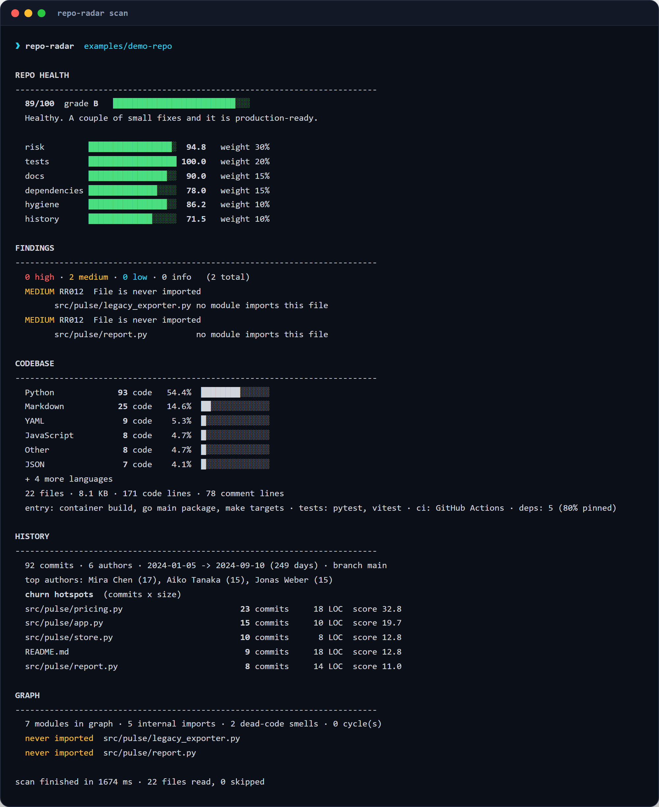
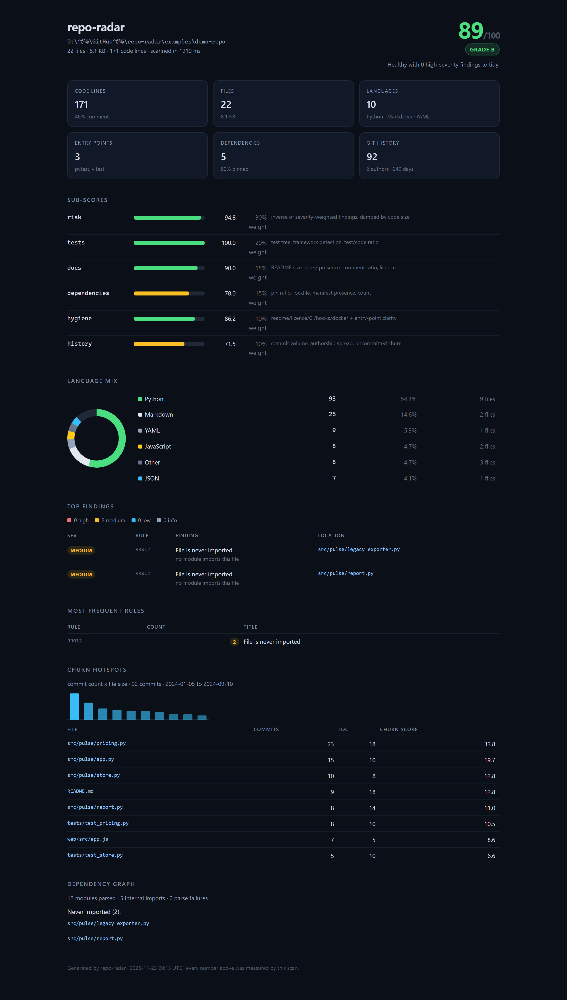
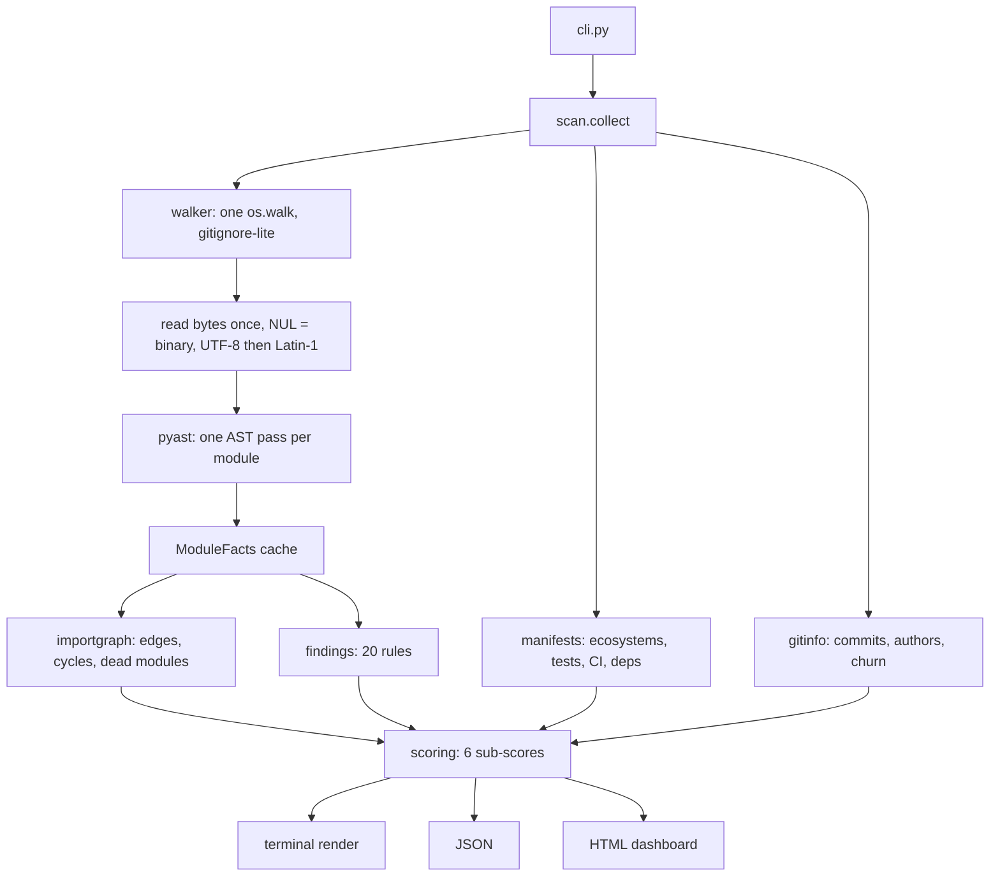

# repo-radar

**Point it at any codebase and get a 0-100 health score, the risk findings that matter, churn hotspots and a self-contained HTML dashboard — in one command, offline, with zero dependencies.**




## The problem

You clone a repository to fix one bug. Before you can, you have to answer a dozen
questions nobody wrote down: what is this, how do I run it, is it tested, why is
`pricing.py` touched every second commit, who wrote the thing, and is there a
`verify=False` in the HTTP client? Answering them means opening twenty files,
running `git log` three ways, and grepping for patterns you half remember.

Existing code-quality tools answer one of those questions each: a linter sees
one file, a coverage report sees one test run, a UI dashboard needs a database
and a network. Nothing gives you a *first-pass opinion about the whole
repository* in the time it takes to read the README — and nothing does it on a
locked-down CI box with no dependencies installed.

## What it does

- **A single health score (0-100)** built from six weighted sub-scores — risk,
  tests, docs, dependencies, hygiene and git history. Every weight and formula is
  published in [docs/scoring.md](docs/scoring.md), so you can reproduce a score by hand.
- **20 risk rules** with stable ids (`RR001`-`RR020`), a severity and a concrete
  fix: hardcoded credentials, dynamic evaluation, unsafe deserialisation, shell
  injection, disabled TLS verification, mutable default arguments, dead modules,
  giant files and more. Full table in [docs/rules.md](docs/rules.md), including
  the `radar:ignore` inline suppression token and why docs and fixtures are exempt.
- **Git-aware history**: commits, authors, first/last commit, and *churn hotspots*
  ranked by `commits x sqrt(size)` — the file that changes most often and is big
  is the one that will hurt you.
- **An import graph** for Python, JS/TS, Go and Rust: internal edges, import
  cycles, and modules nothing imports (the dead-code smell).
- **Language mix** for 30+ languages, split into code / docs / data / config so a
  JSON fixture does not inflate your LOC.
- **`explain <file>`**: public API, docstring coverage, imports and a complexity
  proxy for one module, from a single AST pass.
- **`report`**: one self-contained HTML file with inline CSS and inline SVG. No
  CDN, no JavaScript, no network — it opens on an air-gapped laptop.
- **Deterministic JSON** for every command, so it drops into CI without parsing
  the pretty terminal output.

## Install

repo-radar is **not on PyPI yet**. Install it from source; it has no runtime
dependencies beyond the Python standard library.

```bash
git clone https://github.com/kele-tao/repo-radar
cd repo-radar
python -m pip install -e .
```

Python 3.10 or newer. Nothing else.

## Usage

### 1. Scan a repository

```console
$ python -m repo_radar scan examples/demo-repo --top 8 --colour
repo-radar  examples/demo-repo

REPO HEALTH
--------------------------------------------------------------------------
  89/100  grade B   █████████████████████████░░░
  Healthy. A couple of small fixes and it is production-ready.

  risk         █████████████████░  94.8   weight 30%
  tests        ██████████████████ 100.0   weight 20%
  docs         ████████████████░░  90.0   weight 15%
  dependencies ██████████████░░░░  78.0   weight 15%
  hygiene      ████████████████░░  86.2   weight 10%
  history      █████████████░░░░░  71.5   weight 10%

FINDINGS
--------------------------------------------------------------------------
  0 high · 2 medium · 0 low · 0 info   (2 total)
  MEDIUM RR012  File is never imported
        src/pulse/legacy_exporter.py no module imports this file
  MEDIUM RR012  File is never imported
        src/pulse/report.py          no module imports this file

CODEBASE
--------------------------------------------------------------------------
  Python             93 code   54.4%  ████████░░░░░░
  Markdown           25 code   14.6%  ██░░░░░░░░░░░░
  YAML                9 code    5.3%  █░░░░░░░░░░░░░
  JavaScript          8 code    4.7%  █░░░░░░░░░░░░░
  Other               8 code    4.7%  █░░░░░░░░░░░░░
  JSON                7 code    4.1%  █░░░░░░░░░░░░░
  + 4 more languages
  22 files · 8.1 KB · 171 code lines · 78 comment lines
  entry: container build, go main package, make targets · tests: pytest, vitest · ci: GitHub Actions · deps: 5 (80% pinned)

HISTORY
--------------------------------------------------------------------------
  92 commits · 6 authors · 2024-01-05 -> 2024-09-10 (249 days) · branch main
  top authors: Mira Chen (17), Aiko Tanaka (15), Jonas Weber (15)
  churn hotspots  (commits x size)
  src/pulse/pricing.py                        23 commits     18 LOC  score 32.8
  src/pulse/app.py                            15 commits     10 LOC  score 19.7
  src/pulse/store.py                          10 commits      8 LOC  score 12.8
  README.md                                    9 commits     18 LOC  score 12.8
  src/pulse/report.py                          8 commits     14 LOC  score 11.0

GRAPH
--------------------------------------------------------------------------
  7 modules in graph · 5 internal imports · 2 dead-code smells · 0 cycle(s)
  never imported  src/pulse/legacy_exporter.py
  never imported  src/pulse/report.py

scan finished in 634 ms · 22 files read, 0 skipped
```

### 2. Explain one module

```console
$ python -m repo_radar explain src/repo_radar/scoring.py
repo-radar  explain  scoring.py

MODULE
--------------------------------------------------------------------------
  A Python module exposing 2 functions: grade_for, weighted_score.
  Python · 42 lines · 33 code · 0 comments · 9 blank
  complexity 7 · hardest grade_for (2 branch points) · docstring coverage 100%
  docstring: Scoring: six weighted sub-scores and the 0-100 health sco…

PUBLIC API
--------------------------------------------------------------------------
  * function grade_for                L30  Letter grade for a 0-100 score.
  * function weighted_score           L38  Weighted mean of the six sub-scores, rounded to one decimal.

IMPORTS
--------------------------------------------------------------------------
  __future__.annotations
```

### 3. Generate a dashboard for a PR or a wiki

```bash
repo-radar report . --out dashboard.html
```



The dashboard is a single file: inline CSS, inline SVG bars, no external
requests. Regenerate it with `python scripts/make_artifacts.py`, which runs the
real CLI and the screenshot helper — nothing in `docs/` is hand-written.

### 4. Use it as a quality gate

```bash
repo-radar scan . --fail-under 80 --quiet
echo $?   # 0 when the score is >= 80, 1 when it is not
```

### Exit codes

| Code | Meaning |
| ---: | ------- |
| 0 | success |
| 1 | the score is below `--fail-under`, or the repository could not be read |
| 2 | usage error: unknown flag, missing path, wrong output extension |

### Configuration

Precedence is **CLI > environment > `.radar.yml` > `.radarignore`**:

```yaml
# .radar.yml
ignore:
  - examples/demo-repo
  - "*.min.js"
fail_under: 60
top: 10
```

```bash
REPO_RADAR_FAIL_UNDER=75 REPO_RADAR_IGNORE="build,vendor" repo-radar scan .
```

## How it works



**One read, one parse.** Every file is read as bytes exactly once. NUL bytes mark
it as binary before any decoding is attempted, which is what keeps the tool from
trying to tokenize a PNG. Python modules are parsed once into a `ModuleFacts`
record — imports, public symbols, asserts, bare excepts, mutable defaults,
wildcard imports — and that record is shared by the graph builder and the rule
engine. A second full-tree walk would roughly double the cost; the benchmark
below shows the effect of doing it once.

**A cheap screen before the expensive rules.** Rule scanning starts with a
substring screen over the lowercased file. Generated code, fixtures and most
application code contain none of the trigger tokens, so the per-line loop never
starts for them. On the 5 MB corpus this is the difference between ~3.3 s and
~0.8 s.

**Everything degrades.** No git binary, no `.git`, a shallow clone, a file with a
byte-order mark, a syntax error, a broken `.radar.yml`, a path with CJK or emoji
characters, a symlink loop — each of those is a data point with a reason, never a
traceback. The CLI converts user mistakes into a one-line message and exit code 2.

## Design decisions

1. **Zero runtime dependencies, stdlib only.** `tomllib`, `ast`, `subprocess`,
   `http`-free HTML generation. The scanner is meant to run in a CI container that
   has nothing installed, and a supply-chain audit tool that itself drags in
   fifteen packages is a joke. The cost: no `pathspec` (so gitignore support is a
   deliberate subset), no rich/click (so the renderer is ~200 lines of my own), and
   no tree-sitter (so JS/TS analysis is import-level, not semantic).
2. **The git binary is a subprocess, not a library.** `pygit2`/GitPython would add
   a C dependency and a version-matching problem for a section that needs six
   commands. `git -C <root>` with a scrubbed environment is faster to implement,
   impossible to get subtly wrong, and fails cleanly when git is absent.
3. **A score you can recompute, not a magic rating.** Six sub-scores with published
   weights, a documented damping function, and `--json` exposing every input. A
   score that cannot be explained is a score nobody acts on.

## Performance

<!-- BENCH:START -->
| Files | Code lines | Median scan | Best scan | Files/s | Findings |
| ----: | ---------: | ----------: | --------: | ------: | -------: |
| 549 | 5,750 | 312.0 ms | 270.5 ms | 1,760 | 1 |
| 2049 | 22,850 | 1997.8 ms | 1843.4 ms | 1,026 | 1 |
| 5049 | 57,050 | 4223.6 ms | 3869.5 ms | 1,195 | 1 |
| 76 | 300,001 | 1057.3 ms | 1037.7 ms | 72 | 227 |

Measured with `python benchmarks/run.py` on Windows, Python 3.12.10. Every row scans a tree generated in a temporary directory with git history disabled, median of three runs. The last row is a single 5 MB corpus of unusually large modules - the worst case for the per-file rules.
<!-- BENCH:END -->

The same numbers, raw: [benchmarks/results.json](benchmarks/results.json).

A 5 MB source corpus (76 modules, 300k code lines) scans in about 1 s; 5,000
files (57k code lines) in about 4.2 s, roughly 1,200 files per second. There is
no network access in any of this: the benchmark generates its own tree in a
temporary directory on every run, so anyone can reproduce these numbers.

## Comparison

| Tool | Sees | Needs | Gives you a repo-level opinion |
| ---- | ---- | ----- | ------------------------------ |
| **repo-radar** | whole tree + git history | Python 3.10, nothing else | yes: score, risks, churn, dashboard |
| ruff / eslint | one file at a time | the toolchain's runtime | no: style and correctness per file |
| SonarQube | whole repo | a server, a database, plugins | yes, but it is a platform to operate |
| `git log` / `git shortlog` | history | git | churn numbers, no risk analysis |
| `cloc` / `tokei` | files | a binary | line counts only |

Where the alternatives are better: ruff has hundreds of well-tested rules and
autofixes; SonarQube has real dataflow analysis, historical trends and a UI that a
team can share; `cloc` counts languages more precisely. repo-radar deliberately
does *not* try to be a linter — it is the ten-minute reconnaissance you do before
you decide what to run.

## Development

```bash
python -m pip install -e ".[dev]"
pytest -q            # 173 tests, no network
ruff check .         # clean at line-length 100
python benchmarks/run.py
python scripts/make_artifacts.py   # regenerate docs/ from the real CLI
```

The demo target is `examples/demo-repo`, a small multi-language service whose
history ships as a git bundle (`examples/demo_history.bundle`) and is materialised
by `python examples/build_demo_repo.py`. The fixture is a demo target, not this
tool's own source: run `repo-radar scan .` on this repository to see what the
radar thinks of itself.

## Roadmap

- **Semantic diff mode**: `repo-radar delta <before> <after>` that reports how the
  score moved between two checkouts and which finding caused it.
- **Rule configuration**: per-rule severity and ignore lists in `.radar.yml`, with
  a documented set of thresholds instead of module constants.
- **Tree-sitter-free JS/TS complexity**: count branches from a lightweight token
  scan so `explain` gives the same insight for TypeScript as for Python.
- **Deeper git analytics**: bus factor per directory and co-change coupling
  (files that always change together), both cheap once the log is parsed.
- **SARIF output** so findings can be uploaded to GitHub code scanning.

## Contributing

Bug reports and rule proposals are welcome — see [CONTRIBUTING.md](CONTRIBUTING.md)
for the development setup and the ground rules (no new runtime dependencies, every
number reproducible). Security reports: [SECURITY.md](SECURITY.md).

## License

MIT — see [LICENSE](LICENSE). Copyright (c) 2026 kele.