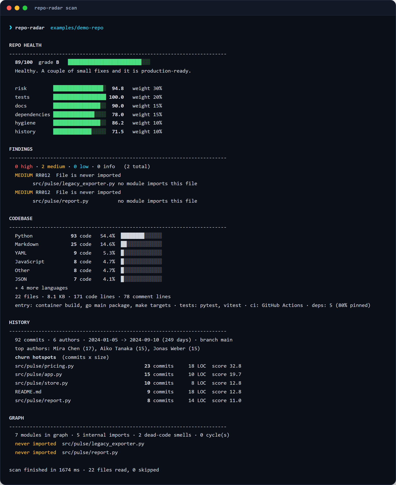
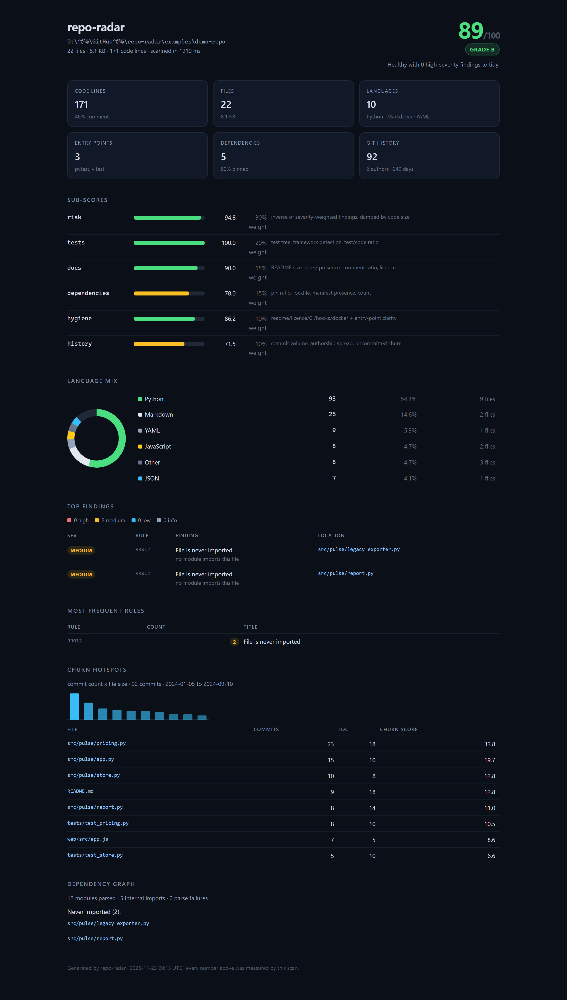
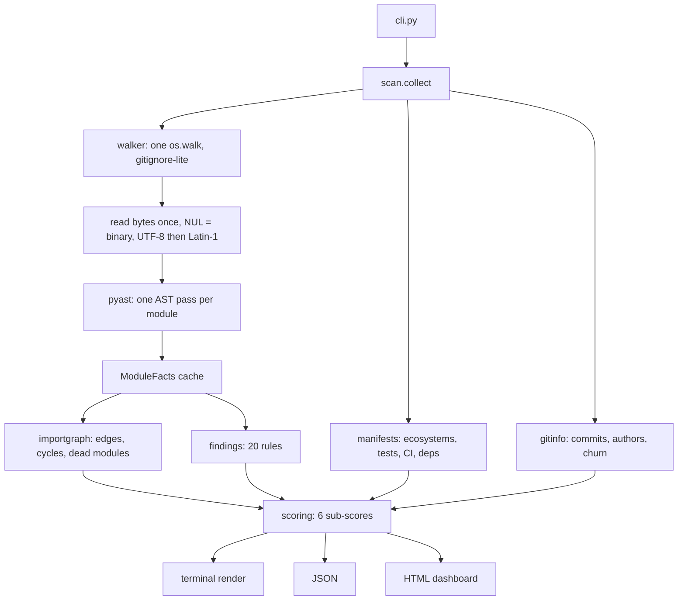

# repo-radar

[English](README.md) | **简体中文**

**把它指向任意一个代码库，一条命令就能拿到 0-100 的健康分、真正值得关注的风险发现、变更热点，以及一份自包含的 HTML 仪表盘——离线运行，零依赖。**




## 问题

你克隆一个仓库，只是为了修一个 bug。但在动手之前，你得先回答十几个没人写下来的问题：这是个什么项目，怎么把它跑起来，有没有测试，为什么每隔一个提交就会动到 `pricing.py`，这东西到底是谁写的，HTTP 客户端里是不是还藏着 `verify=False`？要回答这些，你往往得打开二十个文件、用三种方式跑 `git log`，再凭模糊记忆 grep 各种模式。

现有的代码质量工具各自只回答其中一个问题：检查器一次只看一个文件，覆盖率报告只看一次测试运行，可视化仪表盘则需要数据库和网络。没有任何工具能在你读完这份 README 的时间里，给出一个*关于整个仓库的初步判断*；也没有任何工具能在一台装不了依赖、被锁死的 CI 机器上做到这一点。

## 它能做什么

- **一个单一健康分（0-100）**，由六个加权子分数构成——风险（risk）、测试（tests）、文档（docs）、依赖（dependencies）、卫生（hygiene）和 Git 历史（history）。每一个权重和公式都公开在 [docs/scoring.md](docs/scoring.md) 里，你可以手工复算出同一个分数。
- **20 条风险规则**，每条都有稳定的 id（`RR001`-`RR020`）、严重级别和具体的修复方案：硬编码凭据、动态求值、不安全的反序列化、Shell 注入、关闭 TLS 校验、可变默认参数、死模块、超大文件等等。完整表格见 [docs/rules.md](docs/rules.md)，其中还说明了 `radar:ignore` 行内抑制标记，以及文档和测试夹具为什么被豁免。
- **感知 Git 的历史分析**：提交数、作者、首次与末次提交，以及按 `commits x sqrt(size)` 排序的*变更热点*——改动最频繁、体量又大的那个文件，就是将来最可能让你难受的文件。
- **导入图**，覆盖 Python、JS/TS、Go 和 Rust：内部依赖边、循环导入，以及没有被任何模块导入的模块（死代码症状）。
- **语言构成**，覆盖 30+ 种语言，并拆分为代码 / 文档 / 数据 / 配置四类，这样一份 JSON 测试夹具就不会把你的 LOC 撑大。
- **`explain <file>`**：对单个模块给出公开 API、docstring 覆盖率、导入信息和一个复杂度代理指标，只需一遍 AST 遍历。
- **`report`**：产出单个自包含的 HTML 文件，CSS 内联、SVG 内联。没有 CDN、没有 JavaScript、不访问网络——在断网的笔记本上也能打开。
- 每条命令都有**确定性的 JSON** 输出，因此可以直接接进 CI，而不必去解析漂亮的终端输出。

## 安装

repo-radar **还没有发布到 PyPI**。请从源码安装；除 Python 标准库之外，它没有任何运行时依赖。

```bash
git clone https://github.com/kele-tao/repo-radar
cd repo-radar
python -m pip install -e .
```

需要 Python 3.10 或更高版本，别的什么都不需要。

## 用法

### 1. 扫描一个仓库

```console
$ python -m repo_radar scan examples/demo-repo --top 8 --colour
repo-radar  examples/demo-repo

REPO HEALTH
--------------------------------------------------------------------------
  89/100  grade B   █████████████████████████░░░
  Healthy. A couple of small fixes and it is production-ready.

  risk         █████████████████░  94.8   weight 30%
  tests        ██████████████████ 100.0   weight 20%
  docs         ████████████████░░  90.0   weight 15%
  dependencies ██████████████░░░░  78.0   weight 15%
  hygiene      ████████████████░░  86.2   weight 10%
  history      █████████████░░░░░  71.5   weight 10%

FINDINGS
--------------------------------------------------------------------------
  0 high · 2 medium · 0 low · 0 info   (2 total)
  MEDIUM RR012  File is never imported
        src/pulse/legacy_exporter.py no module imports this file
  MEDIUM RR012  File is never imported
        src/pulse/report.py          no module imports this file

CODEBASE
--------------------------------------------------------------------------
  Python             93 code   54.4%  ████████░░░░░░
  Markdown           25 code   14.6%  ██░░░░░░░░░░░░
  YAML                9 code    5.3%  █░░░░░░░░░░░░░
  JavaScript          8 code    4.7%  █░░░░░░░░░░░░░
  Other               8 code    4.7%  █░░░░░░░░░░░░░
  JSON                7 code    4.1%  █░░░░░░░░░░░░░
  + 4 more languages
  22 files · 8.1 KB · 171 code lines · 78 comment lines
  entry: container build, go main package, make targets · tests: pytest, vitest · ci: GitHub Actions · deps: 5 (80% pinned)

HISTORY
--------------------------------------------------------------------------
  92 commits · 6 authors · 2024-01-05 -> 2024-09-10 (249 days) · branch main
  top authors: Mira Chen (17), Aiko Tanaka (15), Jonas Weber (15)
  churn hotspots  (commits x size)
  src/pulse/pricing.py                        23 commits     18 LOC  score 32.8
  src/pulse/app.py                            15 commits     10 LOC  score 19.7
  src/pulse/store.py                          10 commits      8 LOC  score 12.8
  README.md                                    9 commits     18 LOC  score 12.8
  src/pulse/report.py                          8 commits     14 LOC  score 11.0

GRAPH
--------------------------------------------------------------------------
  7 modules in graph · 5 internal imports · 2 dead-code smells · 0 cycle(s)
  never imported  src/pulse/legacy_exporter.py
  never imported  src/pulse/report.py

scan finished in 634 ms · 22 files read, 0 skipped
```

### 2. 解释单个模块

```console
$ python -m repo_radar explain src/repo_radar/scoring.py
repo-radar  explain  scoring.py

MODULE
--------------------------------------------------------------------------
  A Python module exposing 2 functions: grade_for, weighted_score.
  Python · 42 lines · 33 code · 0 comments · 9 blank
  complexity 7 · hardest grade_for (2 branch points) · docstring coverage 100%
  docstring: Scoring: six weighted sub-scores and the 0-100 health sco…

PUBLIC API
--------------------------------------------------------------------------
  * function grade_for                L30  Letter grade for a 0-100 score.
  * function weighted_score           L38  Weighted mean of the six sub-scores, rounded to one decimal.

IMPORTS
--------------------------------------------------------------------------
  __future__.annotations
```

### 3. 为 PR 或 wiki 生成仪表盘

```bash
repo-radar report . --out dashboard.html
```



仪表盘就是一个文件：内联 CSS、内联 SVG 柱状图，不发起任何外部请求。用 `python scripts/make_artifacts.py` 重新生成它——这个脚本会调用真实的 CLI 和截图辅助程序，`docs/` 里没有任何东西是手写的。

### 4. 当作质量门禁使用

```bash
repo-radar scan . --fail-under 80 --quiet
echo $?   # 0 when the score is >= 80, 1 when it is not
```

### 退出码

| 退出码 | 含义 |
| ---: | ------- |
| 0 | 成功 |
| 1 | 分数低于 `--fail-under`，或者仓库无法读取 |
| 2 | 用法错误：未知 flag、路径缺失、输出扩展名不对 |

### 配置

优先级从高到低为 **CLI > 环境变量 > `.radar.yml` > `.radarignore`**：

```yaml
# .radar.yml
ignore:
  - examples/demo-repo
  - "*.min.js"
fail_under: 60
top: 10
```

```bash
REPO_RADAR_FAIL_UNDER=75 REPO_RADAR_IGNORE="build,vendor" repo-radar scan .
```

## 工作原理



**一次读取，一次解析。** 每个文件都只按字节读取一次。在尝试任何解码之前，先用 NUL 字节判定它是不是二进制文件，这正是本工具不会去给一张 PNG 做分词的原因。Python 模块只被解析一次，产出一条 `ModuleFacts` 记录——导入、公开符号、assert、裸 except、可变默认值、通配符导入——这条记录由导入图构建器和规则引擎共用。再完整遍历一遍目录树差不多会让成本翻倍；下面的基准测试展示了只做一次是什么效果。

**先用便宜的筛选，再上昂贵的规则。** 规则扫描从一次子串筛选开始，对象是转成小写后的文件内容。生成代码、测试夹具和大多数应用代码里一个触发词都不含，于是逐行循环根本不会为它们启动。在 5 MB 的语料上，这就是大约 3.3 s 与大约 0.8 s 的差距。

**一切都能优雅降级。** 没有 git 可执行文件、没有 `.git`、浅克隆、带 BOM 的文件、语法错误、写坏的 `.radar.yml`、包含中日韩字符或 emoji 的路径、符号链接成环——每一种情况都会变成一个带原因的数据点，而绝不是一段 traceback。CLI 会把用户的失误转成一行消息加上退出码 2。

## 设计取舍

1. **零运行时依赖，只用标准库。** `tomllib`、`ast`、`subprocess`，以及不依赖 `http` 库的 HTML 生成。这个扫描器是要跑在什么都没装的 CI 容器里的，而一个自身就要拖进十五个包的供应链审计工具，本身就是个笑话。代价是：没有 `pathspec`（所以 gitignore 支持只是一个刻意取舍的子集），没有 rich/click（所以渲染器是我自己写的约 200 行），也没有 tree-sitter（所以 JS/TS 分析只做到导入级别，做不到语义级别）。
2. **git 二进制用子进程调用，而不是引入库。** `pygit2`/GitPython 会带来一个 C 依赖和一个版本匹配问题，而这段功能只需要六条命令。在清理过的环境变量下执行 `git -C <root>`，实现起来更快，也不会出现那种难以察觉的微妙错误，并且在 git 不存在时能干净地失败。
3. **一个可以复算的分数，而不是玄学评分。** 六个子分数配有公开的权重，一个写进文档的阻尼函数，以及用 `--json` 暴露的每一个输入项。一个解释不清的分数，是没人会照着行动的分数。

## 性能与基准测试

<!-- BENCH:START -->
| 文件数 | 代码行数 | 扫描中位数 | 最佳扫描 | 文件/秒 | 发现数 |
| ----: | ---------: | ----------: | --------: | ------: | -------: |
| 549 | 5,750 | 312.0 ms | 270.5 ms | 1,760 | 1 |
| 2049 | 22,850 | 1997.8 ms | 1843.4 ms | 1,026 | 1 |
| 5049 | 57,050 | 4223.6 ms | 3869.5 ms | 1,195 | 1 |
| 76 | 300,001 | 1057.3 ms | 1037.7 ms | 72 | 227 |

测量方式：在 Windows、Python 3.12.10 上运行 `python benchmarks/run.py`。每一行扫描的都是在临时目录里生成、并禁用了 git 历史的目录树，取三次运行的中位数。最后一行是一个 5 MB 的语料，由体量异常大的模块组成——这是逐文件规则的最坏情况。
<!-- BENCH:END -->

同样的数字，原始数据：[benchmarks/results.json](benchmarks/results.json)。

一个 5 MB 的源码语料（76 个模块、300k 代码行）扫描大约需要 1 s；5,000 个文件（57k 代码行）大约需要 4.2 s，差不多每秒 1,200 个文件。这整个过程没有任何网络访问：基准测试每次运行都会在临时目录里生成自己的目录树，因此任何人都能复现这些数字。

## 对比

| 工具 | 能看到什么 | 需要什么 | 能否给出仓库级判断 |
| ---- | ---- | ----- | ------------------------------ |
| **repo-radar** | 整棵目录树 + Git 历史 | Python 3.10，别的什么都不用 | 能：分数、风险、变更热点、仪表盘 |
| ruff / eslint | 一次一个文件 | 工具链自身的运行时 | 不能：只针对单个文件的风格与正确性 |
| SonarQube | 整个仓库 | 一台服务器、一个数据库、若干插件 | 能，但它是一个需要运维的平台 |
| `git log` / `git shortlog` | 历史 | git | 只有变更数字，没有风险分析 |
| `cloc` / `tokei` | 文件 | 一个二进制程序 | 只有行数统计 |

替代方案更强的地方：ruff 有几百条经过充分测试的规则和自动修复；SonarQube 有真正的数据流分析、历史趋势，以及一个团队可以共享的 UI；`cloc` 统计语言更精确。repo-radar 刻意*不*试图成为一个检查器——它是你在决定要跑什么之前，花十分钟做的那次侦察。

## 开发

```bash
python -m pip install -e ".[dev]"
pytest -q            # 173 tests, no network
ruff check .         # clean at line-length 100
python benchmarks/run.py
python scripts/make_artifacts.py   # regenerate docs/ from the real CLI
```

演示目标是 `examples/demo-repo`，一个小的多语言服务，它的历史以 git bundle 的形式随仓库提供（`examples/demo_history.bundle`），并由 `python examples/build_demo_repo.py` 还原为真实仓库。这份测试夹具只是一个演示目标，不是本工具自己的源码：对本仓库运行 `repo-radar scan .`，就能看到 radar 如何评价它自己。

## 路线图

- **语义 diff 模式**：`repo-radar delta <before> <after>`，报告两个检出之间分数如何变化，以及是哪个发现导致的。
- **规则配置**：在 `.radar.yml` 里按规则配置严重级别和忽略列表，并用一套写进文档的阈值取代模块里的常量。
- **不依赖 tree-sitter 的 JS/TS 复杂度**：用一次轻量的 token 扫描来数分支，让 `explain` 对 TypeScript 给出和 Python 一样的洞察。
- **更深的 Git 分析**：按目录计算的巴士系数（bus factor）和共同变更耦合（总是一起改动的文件），一旦日志解析完成，这两项都很便宜。
- **SARIF 输出**，让发现结果可以上传到 GitHub 代码扫描。

## 参与贡献

欢迎提交 bug 报告和规则提案——开发环境搭建与基本规则（不引入新的运行时依赖、每个数字都可复现）见 [CONTRIBUTING.md](CONTRIBUTING.md)。安全问题请报告到 [SECURITY.md](SECURITY.md)。

## 许可证

MIT——见 [LICENSE](LICENSE)。Copyright (c) 2026 kele。
